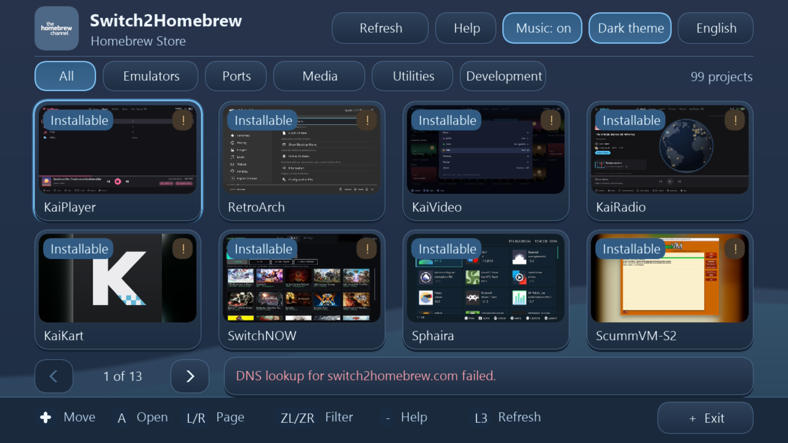
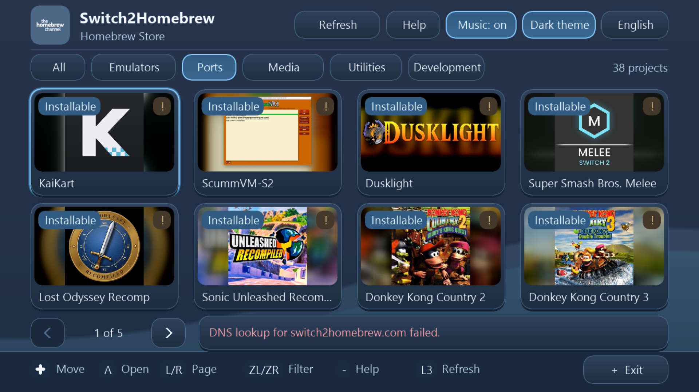

# Switch2Homebrew-Store

Native homebrew catalog and store for Nintendo Switch 2.

[Download the .nro](https://github.com/coldbreathAI/Switch2Homebrew-Store/releases/latest) · [Browse the v0.5.2 source](source/) · [Website](https://switch2homebrew.com/)

## Build

On Windows, install [Ounce Devkit](https://github.com/ouncebrew/ounce-devkit) with libounce and the Switch zlib package (which includes MiniZip). Put Python 3, FFmpeg, CMake and Ninja on your PATH.

From the repository root, run

```powershell
powershell -File .\source\build.ps1 -SdkPath 'C:\path\to\devkitpro'
```

The script also accepts `DEVKITPRO` for the SDK path and `-FfmpegPath` for a separate FFmpeg install. The first build downloads and verifies libwebp 1.6.0 and Noto Sans. The result is `source/build/Switch2Homebrew-Store.nro`.

The default build uses a basic icon, starts without music, and loads covers from the online catalog. To bundle local assets, run `source/build.ps1` from PowerShell with `-IconPath` (a 256×256 JPEG), `-MusicPath` (an audio file), or `-ArtworkManifest` (JSON keyed by catalog ID with a relative `file` path for each cover).

[Third-party notices](source/THIRD-PARTY-NOTICES.txt)

## Screenshots

### Full catalog



### Emulators


### Game ports


